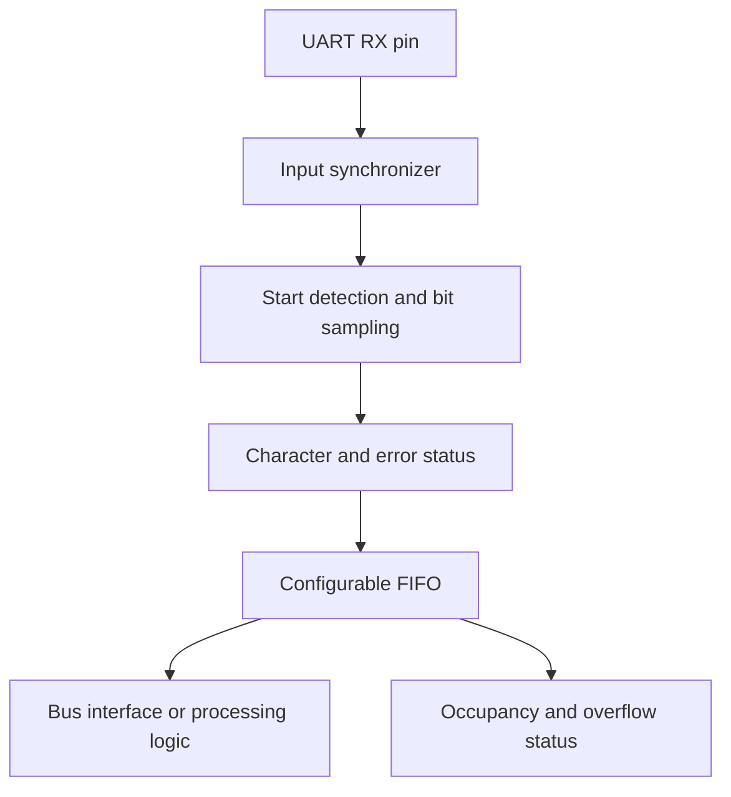
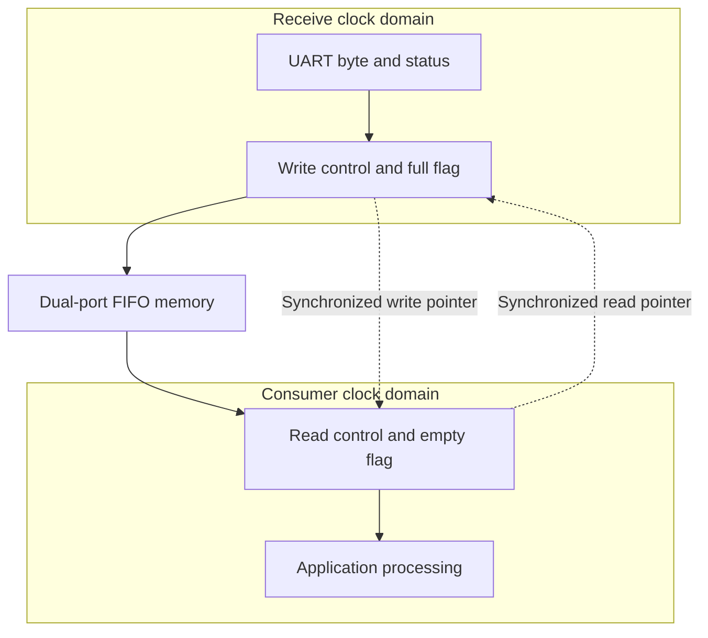

# UART RX with Configurable FIFO Depth: Connecting Asynchronous Data to Predictable Processing

A UART receiver converts a serial stream into parallel data. In a practical embedded system, however, receiving each byte is only part of the problem. The receiving processor or logic may be busy, operate on another clock, or process messages in batches. A configurable FIFO provides space between the arrival of data and the moment the system can consume it.

For an FPGA implementation, the UART receiver and buffer can be designed independently. The receiver handles serial timing and character validation; the FIFO absorbs temporary differences between arrival and processing rates. This separation allows the same receive engine to serve a small command interface or a continuous data acquisition channel simply by changing its buffering and downstream interface.

## Two Meanings of Asynchronous

The term asynchronous describes two different relationships in this design.

**The UART link is asynchronous.** The transmitter sends data without forwarding a clock. The receiver uses its own clock and the configured baud rate to locate the bits in each character. A start bit establishes the timing reference for each new frame.

**The consumer may also be asynchronous to the receiver.** For example, the UART receive logic might operate at 80 MHz while a downstream processing block operates at 100 MHz from an unrelated clock source. Transferring complete bytes between these domains requires a clock domain crossing mechanism.

These are separate design problems. An asynchronous UART input does not automatically require a dual-clock FIFO. If the receiver and consumer use the same FPGA clock, a single-clock FIFO is sufficient. A dual-clock FIFO is needed when the buffer itself connects independent clock domains.

| System relationship | Required mechanism |
|---|---|
| External UART RX pin to FPGA receive logic | Input synchronizer and UART bit sampling |
| Receiver and consumer use the same clock | Single-clock FIFO |
| Receiver and consumer use independent clocks | Dual-clock asynchronous FIFO |
| Software reads periodically through a bus | Buffering sized for the service interval; clock crossing handled wherever the interface requires it |

## The Receive Architecture

A useful design separates the serial front end, byte storage, and application processing.



The input synchronizer reduces the probability that metastability propagates into the receive logic. It does not decode UART data or correct an incorrect baud rate.

The receiver detects a potential start bit, checks that it remains valid, and samples the data near each bit's expected centre. It then checks the configured parity and stop-bit conditions. Oversampling at 8 or 16 times the baud rate is common, although other sampling architectures are possible. Microchip's receiver documentation provides an example of start-bit qualification and oversampled reception [1].

A completed character produces a data value and a valid indication. The FIFO accepts that entry when space is available. The consumer retrieves entries independently of the serial framing process.

The receive logic should run from a suitable FPGA clock, using clock-enable pulses for sampling where practical. A counter-generated baud pulse need not become a separate clock domain.

## What Configurable FIFO Depth Means

FIFO depth is the number of entries the buffer can hold. With eight data bits per entry, a depth of 1,024 stores 1,024 received bytes. If parity and framing status are stored alongside each byte, each entry becomes wider while the number of stored characters remains unchanged.

A reusable RTL block might expose parameters such as:

```systemverilog
parameter int DATA_BITS  = 8;
parameter int FIFO_DEPTH = 1024;
```

These declarations illustrate the configuration interface; they are not a complete UART or FIFO implementation.

Depth is normally chosen at synthesis or IP-generation time. Changing it changes the implemented storage and control logic and requires rebuilding the FPGA image. A runtime programmable interrupt threshold or almost-full threshold is a different feature: it changes when the system reacts, not the physical storage capacity.

Power-of-two depths are especially convenient for conventional Gray-pointer asynchronous FIFOs. Arbitrary depths require explicit support in the FIFO architecture or selected IP. A parameter should therefore document its supported values rather than imply that every positive integer is valid.

## Sizing the Buffer from Service Latency

Buffer size should follow the worst expected period during which the consumer cannot remove data.

For a UART frame containing one start bit, eight data bits and one stop bit, each received byte occupies ten serial bits. With continuous back-to-back frames:

\[
R_{bytes} = \frac{Baud}{10}
\]

At 4 Mbaud using 8N1 framing:

\[
R_{bytes} = 400{,}000\ \text{bytes/s}
\]

If processing can stop for 1 ms, approximately 400 bytes can arrive during that interval. A 512-entry FIFO provides some margin when initially empty, but the design must also allow for existing occupancy, scheduling jitter, flow-control delay and any longer stalls.

A useful first estimate is:

\[
D \ge Q_0 + \lceil R_{bytes}T_{stall}\rceil + M
\]

Here, \(Q_0\) is the maximum occupancy when the stall begins, \(T_{stall}\) is the maximum service interruption, and \(M\) is an engineering margin in entries. This simplified bound assumes no reads during the stall. More general sizing uses the maximum accumulated difference between arrivals and departures.

| FIFO depth | Time to fill from empty at 4 Mbaud, 8N1 |
|---:|---:|
| 256 bytes | 0.64 ms |
| 512 bytes | 1.28 ms |
| 1,024 bytes | 2.56 ms |
| 2,048 bytes | 5.12 ms |
| 4,096 bytes | 10.24 ms |

These values are calculated examples, not a guaranteed service budget. Different framing changes the byte rate, and existing buffered data reduces the available time.

A FIFO absorbs temporary delays. It cannot compensate indefinitely for a consumer whose sustained throughput is below the sustained arrival rate. After a stall, the consumer also needs enough spare throughput to clear the backlog before the next one.

## Crossing Independent Clock Domains

A dual-clock FIFO lets the receiver write under one clock while the consumer reads under another. Altera's FIFO documentation distinguishes single-clock SCFIFO and dual-clock DCFIFO functions for this purpose [2].



In a conventional asynchronous FIFO, each side maintains a local binary pointer. Gray-coded versions of the pointers cross through synchronizers so the opposite side can determine whether data or free space is available. Only one Gray-code bit changes between consecutive pointer values, reducing the hazards associated with transferring a changing multi-bit binary count.

The memory and pointer protocol preserve data ordering. Synchronizing each bit of a received byte independently is not an equivalent solution: the destination could observe a mixture of different values.

Pointer synchronization introduces latency. Empty, full and occupancy information may therefore react conservatively to activity in the opposite domain. The design should use each flag in its specified clock domain and follow the FIFO's timing constraints, reset requirements and output-valid semantics. Altera documents dedicated metastability-protection options for DCFIFO [3].

For MAX 10, use FIFO IP supported by the installed Quartus edition and target device, or a verified portable implementation. Availability and settings should be checked for that exact tool/device combination.

## Using the FIFO with a Periodic Processing Task

Consider an FPGA receiving a continuous UART stream while a processor checks for data every millisecond. Hardware receives and buffers characters immediately. At each service opportunity, software reads a batch and passes it to the message parser.

This removes the requirement to service every individual byte, provided that the buffer and read bandwidth cover the worst service delay. It can also reduce interrupt frequency when the interface supports occupancy thresholds or batch reads.

The processor interface must define how software learns that data is available, how reads remove entries, and whether the reported count is exact or conservative. If DMA is used, the bus interface and DMA handshake must support it; adding a FIFO alone does not create DMA capability.

A byte FIFO does not identify complete packets. Message boundaries still require protocol information such as a length field, delimiter or defined idle interval. CRC checking and packet assembly belong in a parser downstream of reception, unless deliberately implemented in the receive pipeline.

## Comparing an FPGA UART FIFO with a Hard UART and DMA

A hard UART is a dedicated peripheral built into a microcontroller or processor. Its receive logic converts serial characters into data in a receive register or hardware FIFO. Direct memory access (DMA) then transfers that data into system RAM without requiring the CPU to copy every byte.

The typical receive paths are:

| Architecture | Receive path |
|---|---|
| FPGA UART with local FIFO | RX pin → UART logic → FPGA FIFO → application logic or processor interface |
| Hard UART with DMA | RX pin → hard UART register/FIFO → DMA → RAM buffer → software |

Both architectures decouple arrival from processing. The main distinction is where buffering resides and what must keep operating to move data into it. DMA complements the UART's hardware FIFO; it does not increase that FIFO's physical depth.

### Capability and Resource Comparison

| Aspect | FPGA UART with configurable FIFO | Hard UART with DMA |
|---|---|---|
| Receive buffer capacity | Selected through HDL parameters or FIFO IP configuration, within FPGA resource limits | UART FIFO capacity is device-defined; the DMA destination buffer is sized separately in accessible RAM |
| CPU work per byte | No CPU needed for reception into the local FIFO; later transfer and parsing depend on the design | No CPU copy needed for each DMA transfer; software manages buffer consumption, events and parsing |
| Continuous operation | UART and FIFO can run continuously while their clocks, power and reset remain valid | Requires supported circular, linked-descriptor or equivalent continuous DMA operation, correctly configured |
| Timing dependencies | Local storage avoids dependence on a processor bus for initial capture; downstream interfaces may still introduce stalls | Moving bytes into RAM depends on DMA service, bus arbitration and memory availability |
| Buffer configuration changes | Physical depth typically requires FPGA recompilation | RAM buffer size can usually change in software when the channel is safely reconfigured; UART FIFO limits remain fixed |
| Custom behaviour | Can add character timestamps, special framing, hardware packet checks and event logic | Limited to peripheral features unless additional software or hardware is used |
| Clock crossings | Designer implements or integrates the required CDC mechanisms | Internal peripheral and DMA crossings are normally handled by the device; system integration must follow its rules |
| Engineering effort | Requires RTL/IP integration, timing closure and receive-path verification | Uses existing silicon peripherals, but needs DMA, driver, memory and error-recovery integration |
| Resource cost | Consumes FPGA logic and RAM | Consumes a UART instance, DMA resources, RAM and interconnect bandwidth |

Neither approach is inherently interrupt-free. An FPGA interface may use interrupts or polling, and DMA can generate half-transfer, completion, idle or error events depending on the device and driver. These events can often be reduced or selectively disabled, but software still needs a reliable way to identify new data.

### Two Separate Buffering Deadlines

A DMA-based receiver has two deadlines. First, DMA must drain the UART's receive register or FIFO before it overruns. Second, software must consume the RAM buffer before unread data is overwritten or storage is exhausted.

At 4 Mbaud with 8N1 framing, one byte arrives every 2.5 microseconds. A hypothetical empty 16-byte UART FIFO would fill in approximately 40 microseconds if DMA made no progress. A 4,096-byte RAM ring takes approximately 10.24 milliseconds to fill from empty. These calculated examples describe different limits: the large RAM ring protects against software delay, but cannot prevent UART overrun if the DMA transfer itself is stalled too long. Actual margins depend on occupancy, request thresholds and device behaviour.

Similarly, a 4,096-byte FPGA FIFO provides approximately 10.24 milliseconds of storage from empty at this rate. If it feeds a processor or DMA channel, the downstream transfer still needs sufficient sustained bandwidth.

### Circular DMA Is Not Automatically a Protected FIFO

In a circular DMA arrangement, the DMA write position wraps back to the beginning of the RAM buffer. Software maintains its own consumption position. Unless the implementation explicitly prevents it, DMA can overwrite unread data when the producer catches the consumer.

Software must therefore track wraparound and detect data loss. A sampled write index alone may be ambiguous if DMA completes an entire buffer revolution between observations. The design needs a bounded service interval or reliable generation/wrap accounting. On cache-equipped processors, DMA memory must also be accessible to the DMA engine and use an appropriate cache-coherency policy.

An FPGA FIFO can instead reject writes when full and report overflow. That preserves previously accepted data but still loses incoming characters unless the transmitter can be paused. The overflow policy, rather than the storage location alone, determines which data survives.

ST's UART documentation illustrates circular DMA reception with half-transfer, transfer-complete and idle notifications that do not stop circular reception [4]. These are examples of one implementation; DMA capabilities and driver behaviour differ across device families. An idle notification indicates a gap in reception, and represents a packet boundary only when the application protocol defines it that way.

### Choosing the Appropriate Architecture

A hard UART with continuous DMA is often the simpler choice when the processor already provides the required baud rate, framing and DMA features, and the application ultimately processes bytes in software. A suitably sized RAM ring can provide substantial buffering with little CPU involvement in data movement.

An FPGA UART with a local configurable FIFO becomes useful when reception must connect directly to FPGA processing, several channels need independent buffering, or the application needs custom timestamps, framing or hardware event handling. Its autonomy is bounded by its own clock, power, reset and available storage; it does not guarantee survival of failures in shared infrastructure.

The approaches can also be combined: an FPGA UART FIFO can expose a DMA-capable interface so a processor DMA engine transfers batches into RAM. This provides local capture capacity and efficient bulk transfer, provided the interface supports the required handshake and overflow reporting.

## Overflow, Errors and Flow Control

A robust receiver defines what happens when the FIFO fills. One straightforward policy rejects the newest completed character and sets a sticky overflow indication, preserving the order of already accepted entries. An overflow counter provides better diagnostics than a single flag alone.

If the transmitter supports RTS/CTS, the receiver can request a pause before the FIFO becomes full. The almost-full threshold must leave space for characters already in flight and the sender's response delay. UART reception cannot stop the sender simply by deasserting an internal ready signal.

Framing and parity errors can be stored alongside each character or used to discard it. Either policy should be explicit. Dropping a character can invalidate a packet length or CRC, so downstream processing needs a defined recovery strategy after an error or overflow.

A circular buffer that overwrites the oldest entry serves a different purpose from a FIFO that preserves unread data. Overwriting is useful for retaining recent history, but it must be an intentional policy with a way for the consumer to detect lost data.

## Implementation and Verification

Embedded RAM is usually attractive for larger buffers. As a raw storage calculation, 1,024 entries of eight data bits plus two status bits require 10,240 bits. Actual FPGA memory usage depends on RAM block sizes, supported widths and synthesis mapping.

Verification should cover back-to-back frames, baud mismatch within the design's specified tolerance, false starts, framing errors and reset during reception. Buffer tests should exercise full and empty boundaries, pointer wraparound, simultaneous reads and writes, and the selected overflow policy.

For a dual-clock FIFO, test unrelated frequencies and varying phase relationships. Confirm that accepted entries emerge once, in order, and without corruption. Simulation should be complemented by clock domain crossing review and timing analysis: it cannot reproduce physical metastability or prove an implementation safe on its own.

Reset behaviour deserves particular attention. Resetting one side of a running asynchronous FIFO independently may invalidate its state. Follow the chosen implementation's coordinated reset and release procedure, and define what happens if a UART character arrives during recovery.

## A Reusable Interface Between Arrival and Processing

A UART RX block with configurable FIFO depth gives a system designer control over how much processing delay the interface can tolerate. A small buffer suits frequently serviced commands; a larger one accommodates batching, bus contention or temporary software delays.

Its reliability comes from three decisions made together: correct serial sampling, sufficient buffering for the service pattern, and a safe transfer between clock domains where required. With these boundaries defined, the receive path can operate continuously while the surrounding system processes data at its own scheduled opportunities.

## References

1. Microchip, *Asynchronous Receiver*: [start detection and oversampling](https://onlinedocs.microchip.com/oxy/GUID-B822915F-C375-4172-91BD-AB6F326EB783-en-US-1/GUID-D742E4B3-493C-4FD7-8A7C-DE55893B1017.html).
2. Altera, *FIFO Intel FPGA IP User Guide*: [single-clock and dual-clock FIFO functions](https://docs.altera.com/r/docs/683522/24.2/fifo-intel-fpga-ip-user-guide).
3. Altera, *FIFO Metastability Protection and Related Options*: [DCFIFO synchronization and protection settings](https://docs.altera.com/r/docs/683522/24.2/fifo-intel-fpga-ip-user-guide/fifo-metastability-protection-and-related-options).

4. STMicroelectronics, *Description of STM32H7 HAL and Low-Layer Drivers*: [UART DMA reception and receive-event behaviour](https://www.st.com/resource/en/user_manual/um2217-description-of-stm32h7-hal-and-lowlayer-drivers-stmicroelectronics.pdf).

*The architecture and sizing examples in this article are design guidance, not measurements or verification results from a particular repository.*
